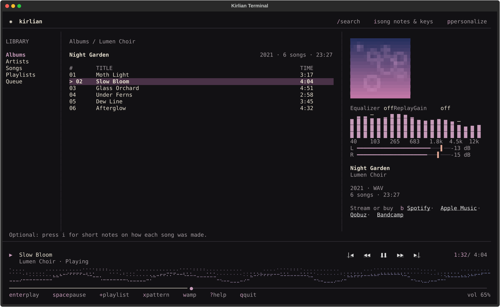
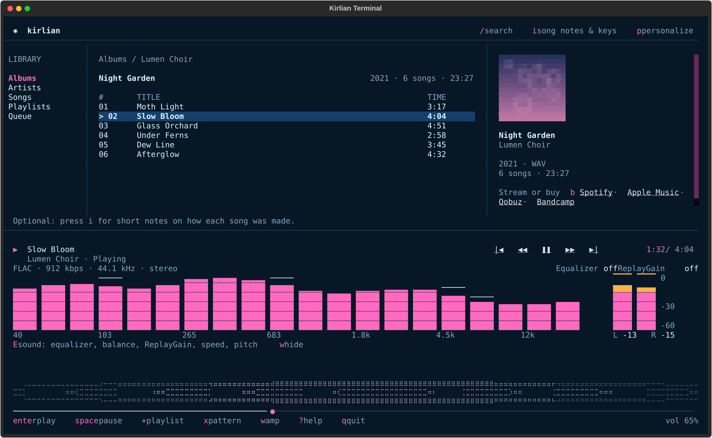

# Kirlian Terminal

A small terminal music player for people who listen to albums.

[Website](https://kirlian.ai/player/terminal) · [Install](#install) ·
[Keys](#keys) · [Kirlian](#kirlian) · [Contributing](CONTRIBUTING.md) · [License](#license)



## About

Kirlian Terminal plays your local music from the keyboard, offline, and keeps your
place in the record. Browse albums, artists, songs, and playlists; watch a ribbon
that moves with the music; open an amp and equalizer; read sourced notes about the
song and the album; and make it yours with palettes and your own themes. Your music
files and tags are never changed, and there is no account.

For a tour of everything it does, see the [website](https://kirlian.ai/player/terminal).

**Platforms:** macOS and Linux. Full-album listening has been checked on macOS,
and a listener has confirmed Linux playback. CI checks both platforms with Python
3.12–3.14, including installation. Windows is not supported.

## Install

You need macOS or Linux, a terminal, and an internet connection for the install.
On macOS, install [Homebrew](https://brew.sh) first if mpv is not already available;
the installer uses it to install mpv. On Linux, install mpv with your package
manager first (commands below). The installer brings uv and Python.

Until the first public release is published, use the source instructions below.
After publication, install or update with:

```sh
curl -fsSL https://github.com/lubizart1/Kirlian-terminal/releases/latest/download/install.sh | sh
```

Then run `kirlian`. The installer sets up [mpv](https://mpv.io) (with Homebrew on
macOS; on Linux it prints the package command, as it never uses sudo) and
[uv](https://docs.astral.sh/uv/), checks the download against its published
checksum, and installs the `kirlian` command. Run it again to update; uninstall with
`uv tool uninstall kirlian-terminal`.

On Linux, install mpv first if you don't have it (`sudo apt-get install mpv`,
`sudo dnf install mpv`, or `sudo pacman -S mpv`). From source, with Python 3.12+, uv,
and mpv:

```sh
git clone https://github.com/lubizart1/Kirlian-terminal.git
cd Kirlian-terminal
uv sync --locked
uv run kirlian
```

## Getting started

Choose your music folder on first launch: type a path, or press **Choose in
Finder…** (**Browse…** on Linux desktops). Albums appear while it indexes. Open an
album with `Enter`, play a song with `Enter`. Quitting keeps your queue and place;
the next launch brings them back paused.

```sh
kirlian --music ~/Music        # index a folder now
kirlian --data-dir /tmp/fresh  # a separate library, for trying things out
kirlian --help
```

## Keys

| Key | Action |
| --- | --- |
| `↑` `↓` / `j` `k` | Move |
| `Enter` · `Esc` | Open or play · back |
| `Space` | Play / pause |
| `/` | Search (arrows pick a result while you type) |
| `n` `N` · `H` `L` | Next / previous song · back / forward 5 s |
| `-` `=` | Volume |
| `a` · `+` | Append to the queue · add to a playlist |
| `w` · `E` | Show the amp · sound settings (equalizer, balance, speed, pitch) |
| `x` · `s` `S` | New ribbon pattern · keep it / recall kept ones |
| `c` | Covers: terminal graphics or blocks |
| `p` | Personalize: palette, motion, characters, language, amp placement |
| `i` · `[` `]` · `o` | Song-notes settings · more notes · open a note's source |
| `b` | Stream or buy the album (Spotify, Apple Music, Qobuz, Bandcamp search) |
| `f` · `r` | Choose folder · rescan |
| `?` · `q` | All keys · quit |

The playbar's controls and progress line are clickable too. Typing in a text field
never triggers a shortcut.

## Song notes

Optional, and off until you turn them on with `i`. Kirlian asks a provider you
choose, with your own API key, for short notes on the playing song and its album,
and shows a note only if its source is a page the provider's search actually
retrieved.

| Provider | Key | Environment variable |
| --- | --- | --- |
| Anthropic | [platform.claude.com](https://platform.claude.com) | `ANTHROPIC_API_KEY` |
| OpenAI | [platform.openai.com](https://platform.openai.com/api-keys) | `OPENAI_API_KEY` |
| Exa | [dashboard.exa.ai](https://dashboard.exa.ai) | `EXA_API_KEY` |
| Perplexity | [perplexity.ai](https://www.perplexity.ai/account/api) | `PERPLEXITY_API_KEY` |
| Parallel | [platform.parallel.ai](https://platform.parallel.ai) | `PARALLEL_API_KEY` |

All five providers have been tested live with their default models. **Anthropic and
Parallel are recommended:** they surface the most interesting insights.

- **What is sent:** title, artist, album, year, and the language to write in.
  Never audio, artwork, file paths, or folder names; untagged files are not asked
  about.
- **Paid once:** answers are saved locally, so each song and each album is
  requested at most once per language, even if you change providers.
- **Keys** live in your system keychain (or the environment), never in Kirlian's
  database. Order providers as primary and fallbacks with `i`.
- Try a key outside the player: `kirlian --check-facts openai` (or `all`).

## Your own themes

```sh
kirlian --new-theme "Deep sea"
```

This writes a commented theme file with every color the player uses (accent,
selection, text, background, and so on). Edit it, press `p`, and pick it under
**Interface palette**; `p` rereads the folder each time, so you can tweak and look
again. Share a theme by sending the file.



Screenshots show the real app with a generated demo library; covers appear as
character blocks here, and as sharp images in terminals with graphics support.

## Privacy and data

Nothing leaves your computer except the opt-in notes request above, and store pages
you choose to open. Kirlian never writes to your music. Its library, settings,
playlists, themes, and saved notes live in:

- macOS: `~/Library/Application Support/kirlian-terminal/`
- Linux: `$XDG_DATA_HOME/kirlian-terminal/` (default `~/.local/share/kirlian-terminal/`)

## Tested and working

The terminal observations below are from macOS; Linux playback has also been
confirmed by a listener. See the [verification record](docs/testing.md#release-verification)
for the scope of those checks. Reports from other setups are welcome
([open a check report](https://github.com/lubizart1/Kirlian-terminal/issues/new?template=check-report.yml)).

| Terminal | Result |
| --- | --- |
| Kitty | Works well, with sharp covers. Its default font is small: `Cmd` `+`, or `font_size 14` in `kitty.conf`. |
| Warp | Works. It runs inside a multiplexer, so covers use blocks. |
| macOS Terminal | Works with 256 colors: simpler borders and dithered covers. Being rechecked. |
| Herdr | Works; blocky covers unless Kitty graphics is enabled in Herdr's settings, then `kirlian --artwork native`. |

In tmux 3.3+, `set -g allow-passthrough on` lets covers through. If a cover stays
blank anywhere, press `c` for blocks, or run `kirlian --check-artwork`.

## Troubleshooting

- **`kirlian: command not found`** after installing: run `uv tool update-shell`,
  then open a new terminal.
- **"mpv is missing"**: install mpv (`brew install mpv`, or your package manager),
  then run `kirlian` again.
- **No music found in `~/Music` on macOS**: the Music app's folder is protected.
  Allow your terminal in System Settings › Privacy & Security › Files and Folders,
  or press `f` and choose another folder.
- **No sound**: check your system output and the volume (`=` raises it). If
  `mpv some-song.mp3` is silent too, the problem is outside Kirlian.
- **Covers blocky or blank**: press `c` to switch between terminal graphics and
  blocks; each terminal remembers its own choice. In tmux or Herdr, see
  [Tested and working](#tested-and-working). `kirlian --check-artwork` shows what
  your terminal can display.
- **No song notes**: press `i` to check that notes are on and a key is set, and run
  `kirlian --check-facts` to test the key. Notes need title and album tags, and the
  record pane needs 110 columns.
- **"Could not save … Is the disk full?"**: free some disk space and make the change
  again; playback carries on meanwhile.
- **Start fresh**: `kirlian --data-dir /tmp/fresh` uses an empty library, or delete
  the data folder listed under [Privacy and data](#privacy-and-data).

## Current limits

- Gapless transitions across formats and the sound effects still need dedicated listening checks.
- The record pane (cover, details, notes) needs 110 columns; the minimum is 80 × 24.
- Identical editions in one flat folder are told apart only by a MusicBrainz release id.
- Translations were written with AI help and await native-speaker review.

## Kirlian

Kirlian Terminal is the small, offline sibling of **[Kirlian](https://kirlian.ai)**,
an LLM-powered music visualization system. If you enjoy watching the ribbon move with
your music, go see what Kirlian does with it.

## Contributing

See [CONTRIBUTING.md](CONTRIBUTING.md), [architecture](docs/architecture.md),
[testing](docs/testing.md), and the [ribbon patterns](docs/patterns.md). Working
with a coding agent? Start it on [AGENTS.md](AGENTS.md).

If you have any problems, suggestions or comments, please email
[hello@kirlian.ai](mailto:hello@kirlian.ai).

## License

Free software under the GNU General Public License, version 3 or later
(`GPL-3.0-or-later`); see [LICENSE](LICENSE) and the [license review](docs/licensing.md).
